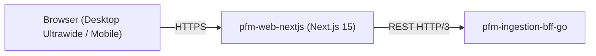

# PFM Web Portal — Next.js 15 (Organic Financial Pulse)

[](CONTRIBUTING.md)
[](CHANGELOG.md)
[](https://sorobanerp.github.io/pfm-docs/)

---

## 1. Visão Geral & Papel na Arquitetura

Portal Web executivo e analítico em **Next.js 15 + React 19 + TypeScript**: Design System **Organic Financial Pulse** (`#8CBA51`, `#DEFF8B`, `#FBCEB5`, `#FF5D6C`), visões de Competência vs. Caixa, Painel **SaaS Admin (`UC-07 / US-12`)** e **Central de Perfil & Família (`UC-08 / US-13`)**.

- **Repositório:** `Sorobanerp/pfm-web-nextjs`
- **Vínculo com `pfm-docs`:** `ADR-001, ADR-003 | US-11, US-12, US-13, US-14`



---

## 2. Pré-requisitos & Variáveis de Ambiente

### Pré-requisitos
- Node.js `20+` / `22+` e `npm`
- Playwright (para testes E2E)

### Variáveis de Ambiente (Sem Segredos Hardcoded)
| Variável | Padrão Local | Descrição |
| :--- | :---: | :--- |
| `PORT` | `18300` | Porta local do servidor Next.js |
| `NEXT_PUBLIC_API_URL` | `http://localhost:18080` | URL do Edge Gateway / Ingestion BFF |

> **Segurança (Zero-Trust):** Nunca commite tokens, senhas, chaves AWS ou strings de conexão com credenciais reais. Utilize `.env` local (ignorado no `.gitignore`) ou AWS Secrets Manager / GitHub OIDC.

---

## 3. Como Executar Localmente

```bash
npm ci
PORT=18300 NEXT_PUBLIC_API_URL=http://localhost:18080 npm run dev
# Acesse: http://localhost:18300
```

---

## 4. Como Testar e Validar

```bash
npm run lint
npm test -- --coverage
npx playwright test
```

---

## 5. Como Provisionar / Validar na Nuvem

1. Fluxo Gitflow: `feat/*` $\rightarrow$ `develop` $\rightarrow$ `release/vX.Y.Z` $\rightarrow$ `main`.
2. Build gera imagem OCI standalone `linux/arm64` implantada via `pfm-web-infra`.

Consulte [CONTRIBUTING.md](CONTRIBUTING.md) para regras de Conventional Commits e [CHANGELOG.md](CHANGELOG.md) para histórico de versões.
